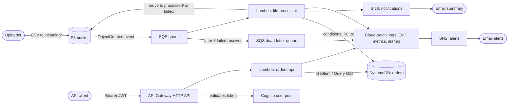

<<<<<<< HEAD
# orderflow-aws-serverless-pipeline
Event-driven serverless order ingestion pipeline on AWS: S3 → SQS → Lambda → DynamoDB, with DLQ/redrive, a Cognito-secured API Gateway REST API, and CloudWatch monitoring.
=======
# Serverless Event-Driven Order Ingestion Pipeline on AWS

A **fully serverless, event-driven data pipeline** built with native AWS services: CSV files uploaded to S3 are
queued, validated and loaded into DynamoDB by Lambda - with retries, dead-letter handling, email summaries -
and a **Cognito-secured REST API** to query the results. No servers to patch, and it scales to zero when idle.

> **About this project:** a self-directed hands-on project I built during a career break to deepen my AWS
> serverless and event-driven architecture skills. It was built and tested in my own AWS account; the guides in
> `docs/` document the exact build and `docs/07-testing-and-validation.md` records the tests I ran.

## Architecture



## AWS services used

| Purpose | Services |
|---|---|
| Storage & events | S3 (lifecycle rules, event notifications, TLS-only policy) |
| Decoupling & resilience | SQS standard queue + dead-letter queue + DLQ redrive |
| Compute | Lambda (Python 3.12, arm64) with SQS event-source mapping |
| Data | DynamoDB on-demand, global secondary index, point-in-time recovery |
| API & auth | API Gateway HTTP API, Cognito user pool, JWT authorizer, stage throttling |
| Notifications | SNS (business summaries + operational alerts) |
| Security | IAM roles (one per function, least privilege), S3 Block Public Access, encryption at rest |
| Observability | CloudWatch logs, alarms, dashboard, Logs Insights, Embedded Metric Format custom metrics, AWS Budgets |

## What this project demonstrates

- **Event-driven architecture:** S3 -> SQS -> Lambda decouples uploads from processing and absorbs bursts.
- **Reliability patterns:** at-least-once delivery handled with **idempotent writes**, partial-batch responses, a DLQ with `maxReceiveCount`, and tested **redrive** after an outage.
- **Failure classification:** permanent errors (bad file) are quarantined to `failed/`; transient errors are retried - not everything is blindly retried.
- **Security:** per-function least-privilege IAM, Cognito JWT authentication, queue policy that trusts only one bucket, TLS-only bucket policy, no public access, no secrets in code.
- **Cost control:** no always-on resources, Lambda max concurrency, S3 lifecycle expiry, API throttling, budget alert.
- **Operations:** custom business metrics without extra code or permissions (EMF), alarms on the *right* signals (DLQ depth, message failures, queue age).
- **Safety guard:** S3 event prefix filter prevents the recursive-trigger loop (a classic S3 + Lambda mistake).

## Build it yourself (in order)

| Step | Guide |
|---|---|
| 1 | [S3, SQS and SNS - the event backbone](docs/01-storage-and-messaging.md) |
| 2 | [DynamoDB table + index](docs/02-dynamodb.md) |
| 3 | [IAM roles](docs/03-iam-roles.md) |
| 4 | [Lambda: file-processor](docs/04-lambda-processor.md) |
| 5 | [API Gateway + Cognito + Lambda: orders-api](docs/05-api-and-cognito.md) |
| 6 | [Monitoring and alerts](docs/06-monitoring.md) |
| 7 | [Testing and validation](docs/07-testing-and-validation.md) |
| 8 | [Cost and cleanup](docs/08-cost-and-cleanup.md) |

## Repository layout

```
.
├── src/
│   ├── file_processor/lambda_function.py   # SQS-triggered CSV ingestion
│   └── orders_api/lambda_function.py       # HTTP API handler (read-only)
├── iam/                                    # IAM, queue and bucket policies (JSON)
├── sample-data/                            # Valid, partly-invalid and bad-header CSVs for testing
├── tests/                                  # 19 unit tests against mocked AWS services (optional)
├── docs/                                   # Step-by-step build, test and cleanup guides
└── screenshots/                            # Evidence from the real build (checklist inside)
```

## Key design decisions

| Decision | Reasoning |
|---|---|
| **SQS between S3 and Lambda** (not S3 -> Lambda directly) | Buffering, controlled concurrency, built-in retries and a DLQ for poison messages |
| **Conditional `PutItem` on `order_id`** | SQS can deliver a message twice; the pipeline must be safe to repeat |
| **Partial batch responses** | One bad message does not force the 4 good ones in the same batch to be retried |
| **Permanent vs transient failures** | Retrying a file with the wrong header can never succeed - quarantine it and tell a human |
| **Queue visibility timeout = 6x Lambda timeout** | Prevents a message being re-delivered while it is still being processed |
| **Max concurrency 5 on the event source** | Bounds DynamoDB load and cost during an upload burst |
| **GSI instead of `Scan`** | Predictable latency and cost for "orders by customer" |
| **ID token + JWT authorizer** | Authentication happens in API Gateway, before any Lambda is invoked or billed |
| **Separate IAM role per function** | The API can only read; the processor can only write |
| **Shallow alarms on DLQ depth + custom `MessageFailures`** | Partial-batch responses make the built-in Lambda `Errors` metric look healthy even when messages fail |

## Limits and possible improvements
- Very large files: split with S3 Batch Operations or orchestrate with **Step Functions** instead of one 60 s Lambda
- Per-user authorisation using Cognito groups or claims in the API
- Custom domain with Route 53 + ACM, and AWS WAF in front of the API
- X-Ray tracing and Lambda Powertools for structured logging
- A `Rejected rows` report file written next to the processed CSV
- Event-driven alerting via EventBridge rules in addition to CloudWatch alarms

## Local unit tests (optional)
```bash
pip install -r requirements-dev.txt
pytest tests -v
```

## License
MIT
>>>>>>> e6b05a9 (files added)
